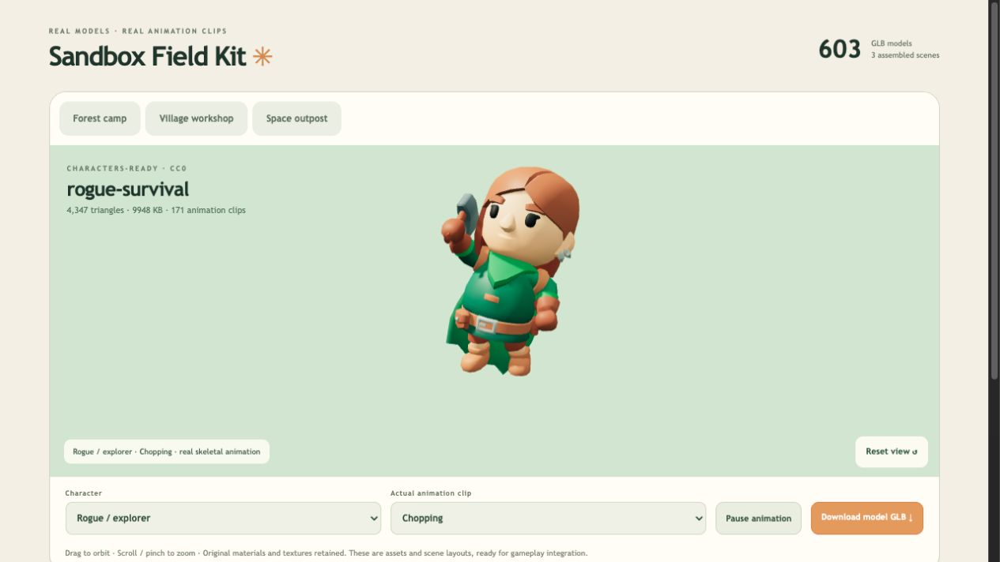

# Sandbox Field Kit

A browser-ready CC0 game asset library for short survival sandbox games: gather resources, craft tools, build a camp, and show visible growth.

- 603 GLB model files including color, character and animation-edition variants.
- 5 character looks; complete 171-clip editions and compact 20-clip editions.
- 3 assembled environment GLBs: forest camp, village workshop and space outpost.
- Dedicated chopping, pickaxing, hammering, digging, sawing, pickup and interaction animation clips.
- Searchable Three.js preview with clip selection and held-tool attachment.

Run `python3 -m http.server 8773` in this folder and visit http://127.0.0.1:8773/ . Start a game with one compact character and one scene, not the entire asset catalog.

These are assets and static layouts, not a completed survival game. Collision, gathering rules, construction, upgrades and saves need game logic. Original licenses and sources are in `licenses/` and `SOURCES.md`. See `README.zh-CN.md` for the Chinese guide.

Original sources: [KayKit Adventurers](https://github.com/KayKit-Game-Assets/KayKit-Character-Pack-Adventures-1.0), [Character Animations](https://kaylousberg.itch.io/kaykit-character-animations).
